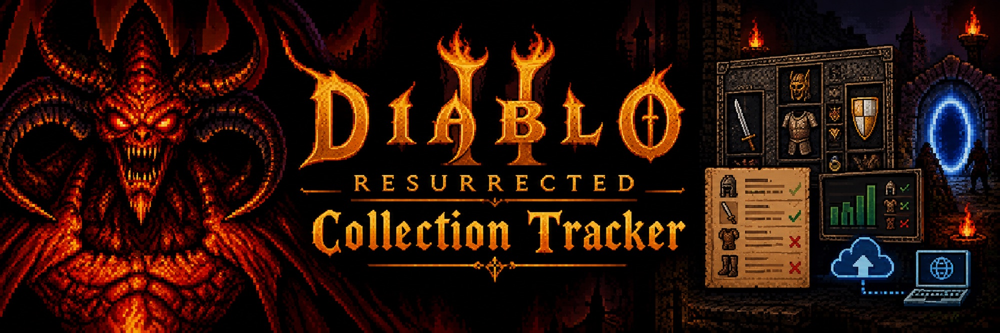
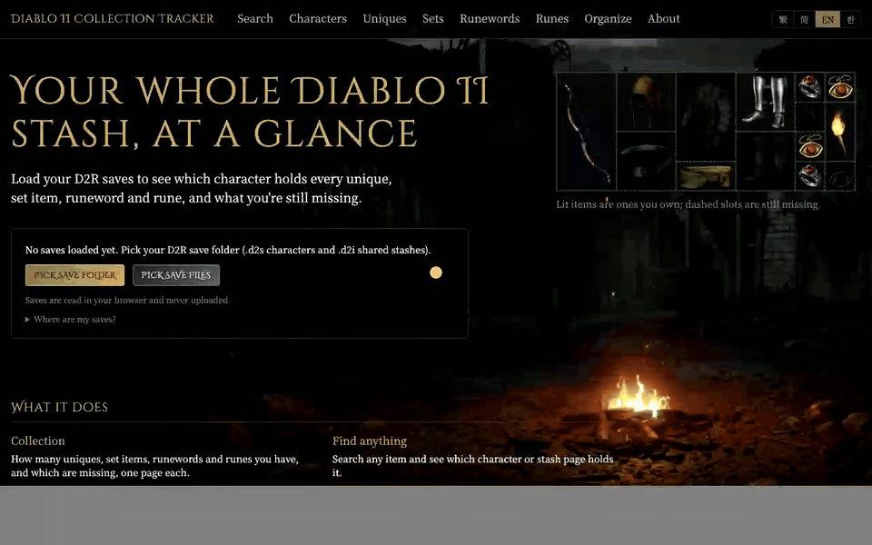
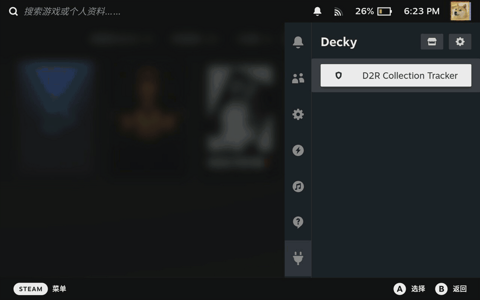

# Diablo II: Resurrected Collection Tracker

[繁體中文](README.zh-TW.md)

Load your D2R save folder and see your whole stash at once: every unique, set item, runeword and rune, which
character or stash page holds it, how many copies you have, and what you are still missing.

**Live site: [d2r.diamonddoge.org](https://d2r.diamonddoge.org)**



Your saves are read in your browser (WebAssembly) and never uploaded. There is no server side, no account and no
tracking.

## What it does

- **New finds.** Drop what you find on the inbox pages of the shared stash and see at once whether each item is
  worth keeping: new to the collection, better than the copy you have, a duplicate some build could still use, or
  extra. It only reads, so it works with the game running.
- **Collection.** Uniques, sets, runewords and runes, each page with how many you own out of how many exist and a
  list of what is missing.
- **Search.** Find any item, owned or not, in any of the four languages, and see where every copy is.
- **Characters.** Each character's equipment, inventory, stash, cube and belt drawn as the in-game grids, with
  item tooltips. Collection mules show their empty slots, so a gap is an item still missing.
- **Build gear.** Pick one of 22 popular builds for a main character, click an equipment slot, and see which of
  the recommended items you have and where they are. The lists come from [Maxroll](https://maxroll.gg/d2/category/guides)
  guides, link back to them, and may be out of date.
- **Organize.** Sort your mules and chosen shared stash pages into numbered mules by fixed rules: uniques and set
  items in fixed "museum" slots (always the best-rolled copy), then duplicates, runewords, charms, jewels, rings,
  magic items, bases, and likely junk for you to look through, including duplicates past what the builds of every
  class could use. Duplicates show whether they rolled better or worse than the museum copy. The page checks that every item is kept exactly once and hands the result back as
  a zip of the whole organized save folder; it never writes to your save folder.
- **Languages.** Traditional Chinese, Simplified Chinese, English and Korean, with the game's own item names.

Works with offline characters on PC and Steam Deck, including Reign of the Warlock saves. Online (Battle.net)
characters live on Blizzard's servers and can't be read; consoles aren't supported.

## Finding your saves

- **Windows:** `%USERPROFILE%\Saved Games\Diablo II Resurrected`
- **Steam Deck:** inside the game's Proton folder, a different path on every Deck.

[docs/saves.md](docs/saves.md) has the steps for both, how to copy saves off a Deck, and how to put organized saves
back (quit the game, back up the folder, then replace its files with the zip's).

## Organizing with your own rules

The web page uses one fixed set of rules. To change them, run the
[organize-stash](.claude/skills/organize-stash/SKILL.md) skill with an AI coding agent such as Claude Code: it
walks through backing up, a dry run explained in plain words, and writing only after you agree, using
`scripts/organize.mjs`.

## Steam Deck plugin

[decky/](decky/README.md) is a [Decky Loader](https://decky.xyz) plugin that opens the tracker from the quick access
menu in Game Mode with the Deck's own saves, and gets the item icons from your installed game. It can also organize
right on the Deck: it refuses while the game runs, backs up the save folder first and reads every written file back.
Emptied characters you tick are deleted, and the Organize page lists the backups (the newest 10 and the oldest are
kept) with buttons to restore or delete them.



It isn't in the Decky store yet. To install: Decky → settings → General → turn on Developer mode, then Developer →
Install Plugin from URL, and enter

```
https://github.com/DozenTwelve/diablo2-tracker/releases/latest/download/d2r-collection-tracker.zip
```

(or download the zip from [Releases](https://github.com/DozenTwelve/diablo2-tracker/releases) and use Install Plugin
from ZIP file). Open the plugin, press "Get item icons" once (about a minute), then "Open collection".

## Development

```bash
npm install
npm run dev
```

The app is React and Vite. `src/lib/` holds the logic (reading saves, item lookups, organizing, translations),
`src/components/` the pages.

- `wasm/` wraps [d2s](https://github.com/ResurrectedTrader/d2s-rs) (MIT) to read and write `.d2s` characters and
  `.d2i` shared stashes. The built package in `wasm/pkg/` is committed, so building the site needs no Rust.
- `src/data/*.json` is generated from the game's own tables and string files, extracted from its CASC storage
  (for example with [casc-cli](https://github.com/ironsp4rk/casc-cli)). Raw game files are not committed.
- Item icons are converted from your own game files into `public/items/` and are git-ignored: no Blizzard art is
  in this repository. Without them the site works, just without pictures.
- `src/data/builds.json` is copied by hand from Maxroll's "Gear Options" tables.

| Command | What it does |
|---|---|
| `npm run gen:data [dir]` | Regenerate item data from extracted game files (default `~/Projects/Diablo2/d2r-gamedata`) |
| `node scripts/gen-images.mjs [dir]` | Convert the game's inventory icons (`data/hd/global/ui/items/<group>/<type>/*.sprite`) to `public/items/*.webp` |
| `npm run deploy` | Build with the local icons and upload to Cloudflare Pages (`npx wrangler login` once first) |
| `npm run build:wasm` | Rebuild the save parser (needs Rust, the `wasm32-unknown-unknown` target and `wasm-pack`) |
| `node scripts/check-saves.mjs <save dir>` | Read a save folder with the app's code and print a summary |
| `node scripts/organize.mjs <save dir> <out dir> [--mode SoftCore:Modern] [--mules a,b] [--inbox 4,5] [--delete a,b] [--yes]` | Organize from the command line: prints the plan, and only with `--yes` writes to a new folder after the same checks as the web page |
| `node scripts/check-organize.mjs <save dir>` | Regression checks for organizing (starting kit, gold, dead heroes, stash copies, running twice...) on a copy of a real save folder in memory |
| `node scripts/check-parse.mjs <save dir>` | Regression checks for reading saves (cut-short stash, corpses, golems, dead heroes, `._` files, New finds verdicts); needs a folder with a `ModernSharedStashSoftCoreV2.d2i` |
| `node scripts/check-props.mjs` | Check every catalog property shows as text |
| `node scripts/check-junk.mjs` | Check the likely-junk rules |
| `node scripts/check-zip.mjs` | Check the zip writer used for organized saves |
| `node scripts/check-builds.mjs` | Check every item in `builds.json` is in the catalog and every text is translated |

[ROADMAP.md](ROADMAP.md) records what was planned and why.

## License

[GPL-3.0](LICENSE). Diablo and Diablo II: Resurrected are trademarks of Blizzard Entertainment, which owns the game
data, item names and art. This project is not affiliated with or endorsed by Blizzard.
